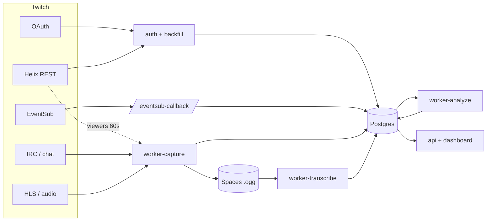

# Stream Intel

Plataforma de analytics multimodal para streamers da Twitch. Captura chat,
eventos (EventSub) e áudio de cada live, transcreve (Whisper), detecta picos
por SQL e gera relatório com LLM: resumo, explicação dos picos, assuntos
ranqueados e recomendações, sempre com evidência clicável verificada contra o
banco. Números vêm sempre de SQL; o LLM só escreve texto que cita fatos já
calculados.

A IA é plugável, trocada por env e não por código: **produção usa OpenRouter**
(Whisper remoto + Claude Haiku/Sonnet), mas o mesmo pipeline roda **100% local**
em dev (faster-whisper + llama.cpp em CPU, sem API paga).

Produção de referência: https://streamintel.cc

## Arquitetura

Responsabilidade de cada componente da infra (com input/output, gatilhos e um
diagrama de fluxo): [`ARCHITECTURE.md`](ARCHITECTURE.md). O layout de pastas
abaixo é o do repositório; a descrição de prod aqui pode estar defasada, o
`ARCHITECTURE.md` é a fonte da verdade do que roda hoje.

```
apps/api           FastAPI: OAuth Twitch, webhook EventSub, API do dashboard
apps/web           React + Vite + Tailwind + Chart.js (build servido pelo Caddy)
workers/capture    IRC do chat, viewers, gravador HLS->Opus, auto-clip nos picos ao vivo
workers/transcribe VAD + Whisper (OpenRouter em prod, faster-whisper em dev)
workers/analyze    picos por SQL + insights via LLM (OpenRouter/llama.cpp), evidência validada
core               modelos, config, filas, crypto, cliente Twitch, métricas, recordes
scripts            simulador de live, seed, benchmark, backup, backfill, prospecção e envio da campanha
deploy             Dockerfile, docker compose (dev + prod), Caddyfile, campanha/ (timers do droplet, histórico)
.actor             actor do Apify: colhe leads todo dia e envia o convite (fora do produto)
migrations         alembic; o job migrate roda `upgrade head` antes de cada deploy
```

Serviços do compose (dev): `api`, `worker-capture`, `worker-transcribe`,
`worker-analyze`, `caddy`, `postgres` e `valkey`. Em produção (App Platform) não
há droplet, Postgres local nem Valkey: a fila de jobs e o dedup do EventSub
vivem no Postgres gerenciado, e o Valkey serve só o simulador de live em dev.

## Fontes de dados da Twitch

Não é uma API só. O sistema puxa dados por cinco caminhos, todos protocolo
oficial da Twitch (nada de scraping de HTML nem GraphQL privado). Todas as
fontes convergem no Postgres; os workers leem de lá e do storage.



| Fonte | Puxa | Grava em | Usado para |
|---|---|---|---|
| **OAuth** (`id.twitch.tv`) | access + refresh token, scopes, identidade (`/users`) | `channels` (token cifrado) | autentica as outras 4 fontes; os scopes definem o que dá pra ler, e o `clips:edit` deixa criar clips ao vivo |
| **Helix REST** (`api.twitch.tv/helix`) | histórico de followers, VODs, subs, bits, metas, VIPs e perfis; ao vivo, viewers + título via `/streams` | `followers`, `past_broadcasts`, `subscriptions`, `bits_leaders`, `goals`, `vips`, `viewer_samples` | dados reais já no connect; base das recomendações; retenção e quedas na análise |
| **EventSub** (webhook `/eventsub/callback`) | 19 tipos de evento ao vivo: subs, bits, follows, raids, enquetes, previsões, hype trains, ads | `events` (+ upsert em `followers`) | timeline por live, contagem por stream, causa das quedas (`dip_cause`) |
| **IRC / TMI** (`irc.chat.twitch.tv:6667`) | cada mensagem de chat: autor, badges, emotes, texto, timestamp | `chat_messages` | detecção de picos que o LLM explica; resumos e assuntos com evidência |
| **HLS** (`twitch.tv/{login}`) | áudio da transmissão (streamlink `audio_only`) | segmentos `.ogg` no Spaces, depois `transcript_segments` | resumo, assuntos e recomendações ancorados em fala real |

O histórico vem por pull (Helix, uma vez no connect). O ao vivo vem por push
(EventSub e IRC) e por polling (viewers no Helix a cada 60s, áudio no HLS).
Durante a live, um pico de chat dispara um clipe automático na Twitch (Helix
`/clips`, scope `clips:edit`), com cooldown e teto por stream: a Twitch só
clipa o momento ao vivo, então a detecção é online (`clip_detector.py`), não
os picos por SQL de pós-live. Os clipes ficam em `twitch_clips` e o streamer
os cura em `GET/PATCH /api/clips`.
Cada webhook é verificado por HMAC-SHA256 e deduplicado por `message_id`;
tokens nunca vão pro log; todo request tem timeout. Detalhe por endpoint no
código: `core/twitch.py`, `core/eventsub.py`, `core/irc.py`,
`core/backfill.py`, `workers/capture/collectors.py`.

## Desenvolvimento local

Pré-requisitos: Docker, uv, Node 20+.

```bash
uv sync                        # deps Python (.venv)
make web                       # build do frontend (apps/web/dist)
make up                        # sobe o stack (Caddy em http://localhost:8080)
```

Portas no host: web/api `8080`, Postgres `5433`, Valkey `6380`.
`deploy/sim.env` fornece defaults de dev (secret do EventSub, whisper tiny,
LLM 1.5B); qualquer valor no `.env` da raiz tem precedência.

Modelos locais (uma vez): baixe um GGUF para `data/models/` e confira o
caminho em `deploy/sim.env` (`LLM_GGUF_PATH`). O whisper baixa sozinho no
primeiro uso.

### Simulação de live (sem Twitch real)

```bash
uv run python scripts/simulate_stream.py --minutes 4 --audio caminho/audio.mp3
```

Publica chat/eventos/viewers/áudio pelos MESMOS caminhos de código da
captura real (webhook assinado, parser IRC). Ao final, a live percorre
transcrição -> análise -> `ready` sozinha.

Para popular o dashboard com todos os estados do pipeline (e uma live
analisável pelo LLM):

```bash
docker compose -f deploy/docker-compose.yml stop worker-transcribe worker-analyze
uv run python scripts/seed_pipeline_states.py            # canal mock
docker compose -f deploy/docker-compose.yml start worker-transcribe worker-analyze
```

### Testes e qualidade

```bash
make lint       # ruff + mypy
make test       # pytest (testes de banco usam o Postgres do compose)
make test-web   # vitest (frontend)
make test-all   # tudo
```

## Variáveis de ambiente

Documentadas em `deploy/env.example`. Essenciais em produção:
`TWITCH_CLIENT_ID/SECRET` (app em dev.twitch.tv com redirect
`https://SEU_DOMINIO/auth/callback`), `TWITCH_EVENTSUB_SECRET` (string
aleatória), `PUBLIC_BASE_URL` (https), `FERNET_KEY`, `DATABASE_URL`,
`SPACES_*` (áudio + backups; sem eles cai em disco local), `SIMULATION=0`.
Para a IA remota (prod): `LLM_BACKEND=openai`, `LLM_BASE_URL` + `LLM_API_KEY`
(OpenRouter), `LLM_MODEL` e `LLM_MODEL_STRONG`, e `TRANSCRIBE_BACKEND=remote`
com `TRANSCRIBE_BASE_URL/API_KEY/MODEL`. Em dev, o default é local (GGUF +
faster-whisper), sem essas chaves.

## Deploy em produção (DigitalOcean App Platform)

Produção roda 100% no App Platform (spec em `deploy/app.yaml`): os componentes
`web`, `api`, `worker-capture`, `worker-transcribe`, `worker-analyze` e o job
`migrate` (PRE_DEPLOY). Estado só no Postgres gerenciado (via pool PgBouncer) e
no Spaces; sem droplet e sem Valkey. A responsabilidade de cada peça está em
[`ARCHITECTURE.md`](ARCHITECTURE.md), a fonte da verdade do que roda hoje.

Deploy é git: **um push na `main` dispara o deploy** de cada componente
(`deploy_on_push: true`). Antes de cada deploy, o job `migrate` roda
`alembic upgrade head`; se a migração falhar, o deploy vira ERROR e a versão
atual continua no ar (funciona como canário). Não há passo manual de migração.

```bash
doctl apps list                          # acha o app (streamintel)
doctl apps get <APP_ID>                  # status + ingress
doctl apps list-deployments <APP_ID>     # histórico de deploys
doctl apps logs <APP_ID> <componente>    # logs em runtime
doctl apps update <APP_ID> --spec deploy/app.yaml   # aplica mudança de infra/spec
```

Segredos (`FERNET_KEY`, `DATABASE_URL`, `TWITCH_*`, `SPACES_*`, `LLM_API_KEY`,
...) ficam como `SECRET` no dashboard do App Platform, nunca no repo. Depois do
primeiro login em `https://streamintel.cc`, as subscriptions EventSub são
registradas automaticamente e qualquer live do canal passa a ser capturada.

Para rodar um comando pontual em prod (ex. backfill), use o console do
componente: `doctl apps console <APP_ID> worker-analyze`.

## Backup e restauração

O Postgres gerenciado da DigitalOcean mantém backups diários automáticos com
point-in-time restore: essa é a camada primária. `scripts/backup_db.py` é o
backup portátil extra (pg_dump -> gzip -> Spaces `backups/` com retenção de 30
dias; sem Spaces, disco local). Rode sob demanda pelo console do componente que
tem o `DATABASE_URL`:

```bash
doctl apps console <APP_ID> worker-capture   # depois: python scripts/backup_db.py
```

Restauração: baixe o `.sql.gz` do Spaces e aplique com `psql` na URL do banco
(sem o sufixo `+psycopg`).

## Operação

- Logs (JSON estruturado): prod `doctl apps logs <APP_ID> api` (ou
  `worker-capture` etc.); dev `docker compose ... logs -f api`
- Healthchecks: api via `/healthz`; workers via ping no banco
- Reprocessar uma live: enfileire um job `analyze` para o stream
  (a análise é idempotente; veja `core/queues.enqueue_job`)
- Re-sincronizar EventSub: refaça o login no dashboard
- Trocar modelo LLM: em prod ajuste `LLM_MODEL` / `LLM_MODEL_STRONG` no App
  Platform; em dev troque o GGUF e o `LLM_GGUF_PATH`
- Recordes das lives antigas: `python scripts/backfill_records.py` pelo console
  (idempotente; distribui os recordes pelo histórico já capturado, e os badges
  só aparecem com 5+ lives analisadas)
- Benchmark de transcrição (dev): `docker compose ... exec worker-transcribe \
  python scripts/benchmark_transcription.py --audio /data/sim/arquivo.wav`
### Prospecção e convite beta

Achar streamer com email público na bio, confirmar o tamanho do canal e convidar
por email frio. Nada disso roda no produto. Tudo roda num **actor do Apify**
(`streamintel-campanha`, id `QonxRkaUpM4tcPsWs`), que é este mesmo código: ele
baixa o estado de um Key-Value Store (`streamintel-campanha`, id
`uvXvn4Kyy4XIL2gAW`) para um diretório temporário, roda os scripts e sobe o
resultado de volta.

#### Como funciona hoje (2026-10-25)

| Peça | O que faz |
|---|---|
| `colher` | todo dia 03:00 `America/Sao_Paulo` (06:00 UTC). `sweep` grátis da Helix (quem está ao vivo em pt e en) + busca paga no Google (`harvest`, só se o freio de gasto deixar) + `qualify` (faixa de seguidores, idioma, MX). Quem passa entra na `fila` como par `(email, idioma)`. |
| `enviar` | segunda a sexta 10:00 `America/Sao_Paulo` (13:00 UTC). Uma trilha por idioma: `lote-N` é pt, `lote-en-N` é en. Cada trilha passa pelo portão e manda até `maximo_por_dia` (160). Grava o progresso a cada bloco de 100. |
| portão (`scripts/campaign_stats.py`) | lê a entrega de cada endereço na API do Resend. Barra o lote se: já saiu; o lote anterior da trilha não saiu; tem **qualquer** spam na janela; bounce duro >= 3% numa janela de pelo menos 200 enviados da mesma trilha. Abaixo de 200 não decide por bounce. Caixa cheia (`Transient`) não conta como bounce duro. Repete 3 vezes em erro 5xx/timeout do Resend. |
| email | `ai-generated-messages/broadcast-body.html` (pt) e `broadcast-body-en.html` (en), do `henrique@send.streamintel.cc`. O link é `https://streamintel.cc/howto?ref=<lote>`: o produto conta visita, clique no Connect e cadastro por lote (tabela `campaign_clicks` e `channels.signup_ref`, ver `CLAUDE.md` da `dev`). Sem pixel de abertura, de propósito. |
| estado no KV | `fila`, `contatados`, `historico`, `candidatos`, `seguidores`, `estado`. A fonte da verdade sobre o que saiu é **sempre a API do Resend**, nunca o `historico`. |

Entradas dos agendamentos (leia na API antes de confiar, elas mudam):

- colher: `{"acao": "colher", "teto_usd": 0, "paginas": 3, "paginas_sweep": 400, "idiomas": "pt,en"}`.
  `teto_usd: 0` desliga a busca paga (decidido em 2026-10-25, a fila en tinha ~8
  semanas). Para religar, volte para 25. O freio compara com o gasto da **conta
  inteira** do Apify no mês, não só da campanha.
- enviar: `{"acao": "enviar", "comecar_em": "2026-08-04", "maximo_por_dia": 160, "minimo_por_dia": 30}`.
  O schema limita `minimo_por_dia` a 200.

#### Publicar o actor

Push no git **não** deploya. Da raiz deste worktree:

```bash
APIFY_USER_TOKEN="$APIFY_TOKEN" python publish_actor.py
```

Ele faz `PUT /v2/acts/QonxRkaUpM4tcPsWs/versions/0.1` com a lista **completa** de
13 arquivos que o `.actor/Dockerfile` copia e depois o build. Regras que já
custaram envio:

- O PUT de `sourceFiles` **substitui tudo**. Mandar só `.actor/` gera build verde
  com imagem sem `scripts/` (2026-08-28). Por isso a lista é fixa no script.
- O script omite `envVars`, o que preserva os 4 segredos (`TWITCH_CLIENT_ID`,
  `TWITCH_CLIENT_SECRET`, `APIFY_USER_TOKEN`, `RESEND_API_KEY`). Reenviar o que a
  leitura devolve dá 400. Segredo é assado na imagem: trocou a chave, refaça o build.
- **Antes** de publicar, compare os `sourceFiles` no ar com o worktree e confirme
  que só os arquivos que você mudou diferem. Guarde a versão no ar para voltar.
- Build verde não prova que a imagem importa. Não existe run de fumaça que não
  mande email (o schema limita `minimo_por_dia` a 200 e a fila tem milhares).
  O que dá para fazer: montar a pasta como o Dockerfile monta e importar
  `main`, `campaign_stats` e `send_campaign_batch` localmente.

Rodar na mão, local (precisa dos CSVs em `data/campaign/`, fora do git):

```bash
python scripts/prospect_leads.py sweep --idiomas pt,en
APIFY_TOKEN=... python scripts/prospect_leads.py harvest --skip 798
python scripts/prospect_leads.py qualify --min-seguidores 500 --max-seguidores 100000000
RESEND_API_KEY=... python scripts/send_campaign_batch.py lote-6 --dry-run
RESEND_API_KEY=... python scripts/campaign_stats.py            # entrega por lote
RESEND_API_KEY=... python scripts/campaign_stats.py --portao lote-24
```

#### Números (medidos em 2026-10-24, fontes: API do Apify, KV, Resend, banco de produção)

- `contatados`: 5.333. `fila`: 7.189 (6.591 en, 598 pt). `candidatos`: 799 mil.
- Desde 2026-09-16: 3.350 emails (3.030 en em `lote-en-1` a `lote-en-20`, 320 pt
  em `lote-22` e `lote-23`). Antes disso, `lote-10` a `lote-21` em pt (julho e agosto).
- Resend, campanha, de 2026-09-28 a 2026-10-24: 2.080 enviados, 28 bounce (1,35%),
  1 suppressed, **0 spam**.
- Trilha pt **barrada** desde 2026-10-15: `PORTAO BLOQUEADO: janela de 320 enviados
  com bounce 28.1%`. A colheita pt recente traz caixa gmail que não existe (22 de
  25 bounces do `lote-22`). Trilha en passa: `janela de 320 enviados com bounce 1.6%`.
- Conversão: 3 cadastros provados (email enviado antes do cadastro) em ~3.140
  enviados desde 16/09, **~0,1%**. Em agosto, no pt, era 0,42% (5 em 1.192).
  Convertidos tinham 6,6 mil a 13 mil seguidores (amostra pequena).
- Quem cadastra fica: dos 19 canais criados desde 01/08, 14 tiveram live capturada
  em outubro. O problema é trazer, não segurar.
- Custo Apify: US$ 27,62 (ciclo 25/08 a 24/09) e US$ 29,05 (25/09 a 24/10). A
  busca no Google (`PROXY_SERPS`) foi US$ 12,87 desse último e **não aparece no
  custo do run**, só no uso da conta.

#### Armadilhas descobertas (todas medidas)

- **Teto da conta Apify para tudo sem aviso.** Em 2026-10-17 a conta bateu US$
  29.05 contra o teto de 29: o run da colheita foi abortado, os agendamentos
  pararam de disparar sem log nenhum e nada saiu até o ciclo virar. O teto agora
  é US$ 40 (2026-10-25). O ciclo vai do dia 25 ao 24.
- **Um 502 do Resend derrubava o dia.** Em 2026-10-16 `classify_bounce` levou
  `502 Bad Gateway` e o envio inteiro falhou. Corrigido com retry (commit `7c8f886`).
- **A trilha pt nunca volta sozinha.** A listagem do Resend guarda uns 27 dias.
  Quando o `lote-23` sumir dela, o portão vai responder `lote-23 nao foi enviado,
  nao pulo a fila` e barrar o pt para sempre. O mesmo vale para a trilha en se
  ela ficar mais de ~4 semanas parada. Destravar exige decisão (ver abaixo).
- **`estado.proximo_lote` diz 22**, mas o histórico já tem `lote-23`. O `enviar`
  deriva o número do `historico`, não desse campo; não confie nele.
- **O email prometia "read-only"** e o app pede `clips:edit` e faz clip sozinho.
  Corrigido no email (commit `41c8336`) e no `/howto`/landing (PR #100).
- Mais antigas, ainda valendo: o Resend recusa o `/emails/batch` inteiro (422) se
  um endereço for inválido, por isso `email_valido()` filtra ponto duplo; a
  verificação de caixa por SMTP não roda em lugar nenhum porque a DigitalOcean
  bloqueia as portas 25 e 587 de saída; `deploy/campanha/` é histórico do droplet
  destruído em 2026-08-03.

#### Feito nos últimos dois meses

| Data | O que |
|---|---|
| 2026-08-28 | Conta Apify e Resend pagas (o 403 parava a colheita); suporte a idioma na fila |
| 2026-08-31 a 09-16 | Envio parado 15 dias por 3 bugs (422 do Resend, portão julgando amostra < 200, corpo en nunca copiado para o container) |
| 2026-09-16 | Os 3 consertados e provados ao vivo: `lote-22` (pt, 160) e `lote-en-1` (en, 50) |
| 2026-09-17 a 10-15 | Envio diário en de `lote-en-2` a `lote-en-20`; `lote-23` pt saiu e barrou a trilha pt |
| 2026-10-17 a 10-24 | Parado pelo teto de US$ 29 da conta Apify |
| 2026-10-25 | Teto para US$ 40; busca paga desligada (`teto_usd: 0`); retry no Resend; link com `ref=<lote>`; texto sem "read-only"; actor publicado (build `fO1x2TVeSOCOGaqoE`) |

#### O que falta e próximos passos

1. **Conferir o primeiro envio com o código novo**: segunda 2026-10-26, 13:00 UTC
   (`lote-en-21`). O link precisa sair com `ref=lote-en-21`.
2. **Ler o funil depois de uma semana de envio**, com a query do `CLAUDE.md` da
   `dev` (precisa do release #99 em produção). É esse número que diz se o
   problema é o assunto, o texto ou a página.
3. Só depois do funil medido, testar uma coisa por vez: email de lembrete para
   quem não cadastrou, prova social (14 streamers ativos, com permissão), assunto
   personalizado com o jogo do canal, faixa de seguidores.
4. **Decidir a trilha pt**: 598 leads parados com colheita ruim. Opções:
   descartar, pagar um verificador de caixa por HTTPS, ou mudar o que o colhedor
   coleta. Hoje nenhuma foi escolhida.
5. **Religar a busca paga** (`teto_usd` de volta a 25) quando a fila en cair
   abaixo de ~3 semanas de envio (~2.400 leads). Na cadência de 800 por semana,
   por volta do fim de novembro de 2026.
6. Fechar o PR #77 (base `feat/campanha-beta`, sem revisor).

A lista e os CSVs são dados pessoais: ficam fora do git (`data/` e `emails*.txt`
no `.gitignore`) e **não têm backup**.

### Impersonar um cliente (suporte/debug)

Ver o dashboard como um cliente vê, para debugar valores ou dar suporte.
Acesso total: enquanto impersonando, a sessão age como a do cliente.

1. Libere seu login na allowlist: `ADMIN_LOGINS=seu_login` (csv para vários),
   e reinicie a `api`. Vazio = ninguém pode impersonar.
2. Faça login normal no dashboard com sua conta (a que está em `ADMIN_LOGINS`).
3. No header aparece um seletor **"Impersonar..."** com os canais cadastrados.
   Escolha um: a página recarrega já vendo o dashboard como aquele cliente.
4. Uma faixa vermelha "Vendo como @cliente" aparece no topo. Clique **Sair**
   para voltar à sua conta.

Via API (mesma coisa que o seletor faz): `POST /api/admin/impersonate/{login}`
e `POST /api/admin/impersonate/stop`, com o cookie de sessão do admin.

Início e fim ficam no log da `api` (`admin X impersonating Y`).
